# Abandoned Graffiti Mill — Früen Mill, Minneapolis

1,896 drone photographs of the abandoned Früen Mill and its graffiti, inside and out, flown on
October 11, 2026. Full-resolution originals with GPS intact, solved camera poses, and a metric
scale from a calibrated bar.

233 of the photographs were taken **inside** the building, at three spots the drone reached
through open window bays, and all but 3 of them solve together with the exterior in one alignment.

CC BY 4.0 for the photographs and data — not for the graffiti in them ([see Notes](#notes)).

## ⬇ Download

### **[→ huggingface.co/datasets/Matt1up/abandoned-graffiti-mill-photogrammetry](https://huggingface.co/datasets/Matt1up/abandoned-graffiti-mill-photogrammetry)**

No account needed. Two ways to take the images:

- **Everything in one file** — [abandoned-graffiti-mill-images.zip](https://huggingface.co/datasets/Matt1up/abandoned-graffiti-mill-photogrammetry/resolve/main/zip/abandoned-graffiti-mill-images.zip), 18.85 GB. All 1,896 originals, uncompressed, in one folder.
- **One file at a time** — the **Files** tab, or the [command line](#download-details). Resumes if the connection drops.

[Sample image](https://huggingface.co/datasets/Matt1up/abandoned-graffiti-mill-photogrammetry/resolve/main/mill/images/DJI_20261011164334_0759_D.JPG)
 · [checksums and camera poses on GitHub](https://github.com/Matt1Up/abandoned-graffiti-mill-photogrammetry-dataset)

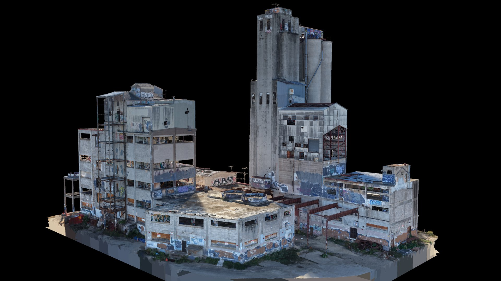

---

## The site

Früen Mill stands in the Bassett Creek valley in Minneapolis. Its buildings date mostly from the
first half of the 20th century and are primarily reinforced concrete. Functionally abandoned for
more than 50 years, it has long drawn urban explorers; it is heavily tagged, and much of the
paint is now peeling. The area has been known for its springs since the 1800s — the Glenwood
and Inglewood spring water companies stood on adjacent properties and later merged.

This dataset is a photographic and 3D record of the mill and its graffiti as they stood on
October 11, 2026.

Captured with the property owner's knowledge and cooperation.

## Inside and out

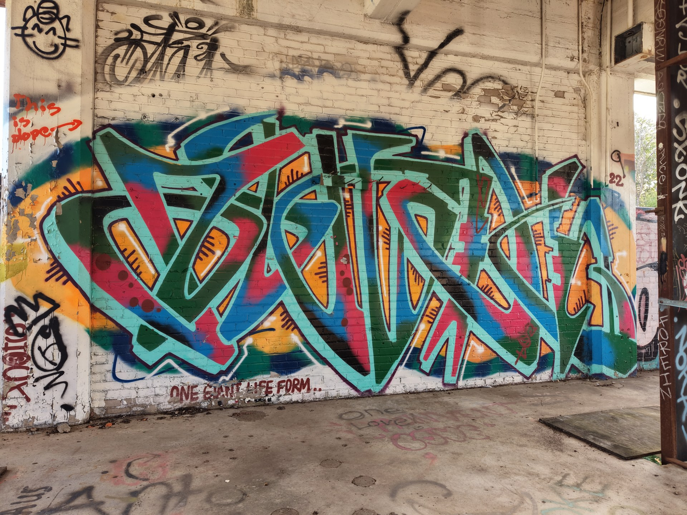

| interior spot | frames | photos | aligned |
|---|---|---|---|
| 1 | `DJI_20261011154027_0898` – `…154259_0938` | 41 | 41 |
| 2 | `DJI_20261011163137_0616` – `…163516_0684` | 69 | 66 |
| 3 | `DJI_20261011164022_0696` – `…164648_0821` | 123 | 123 |

The drone entered each spot through an open window bay, and 230 of the 233 interior photos
solve in the same component as the exterior — interior and exterior in one coordinate frame. The list is [`manifest/mill/interior.txt`](https://github.com/Matt1Up/abandoned-graffiti-mill-photogrammetry-dataset/blob/main/manifest/mill/interior.txt),
picked by eye, and the `interior` column of `images.csv` carries the spot number.

## Gallery

Renders of the textured model reconstructed from these photographs. The model itself is not
part of the dataset.

| | |
|---|---|
| 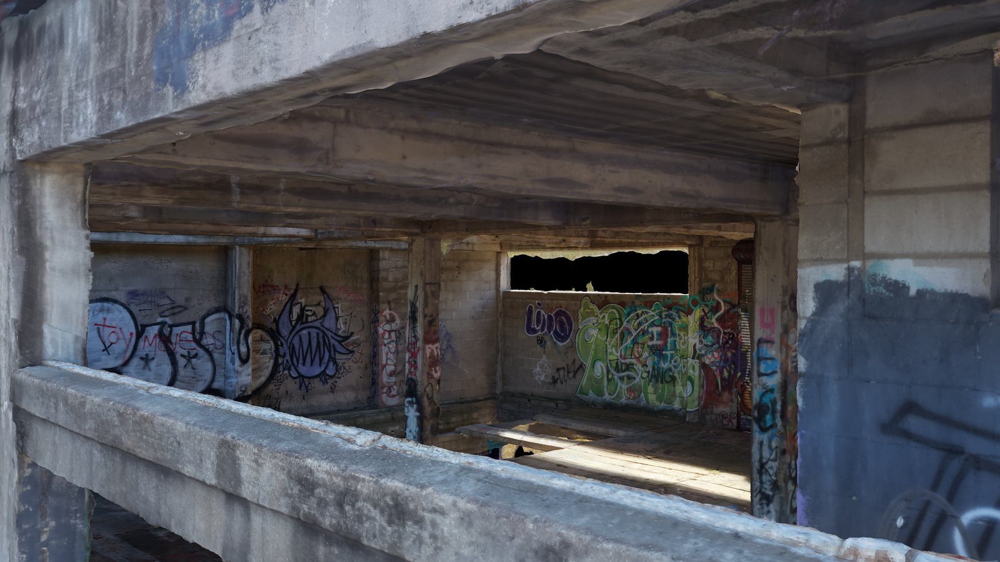 | 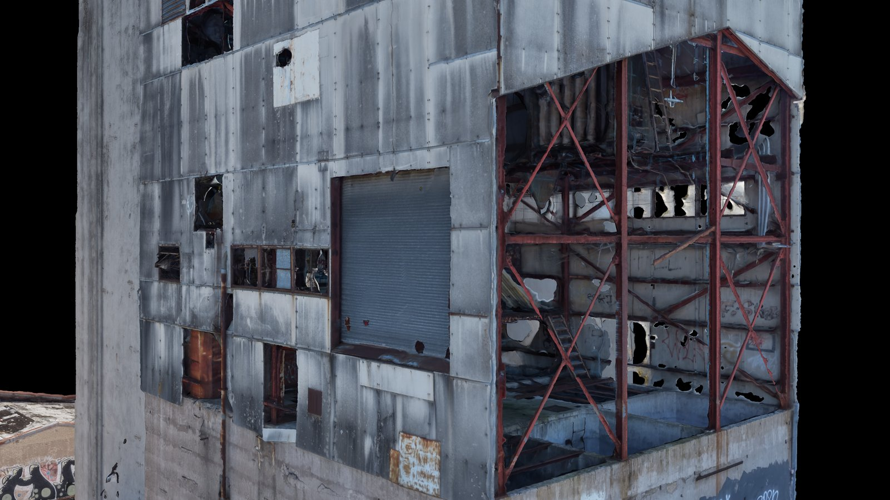 |
| 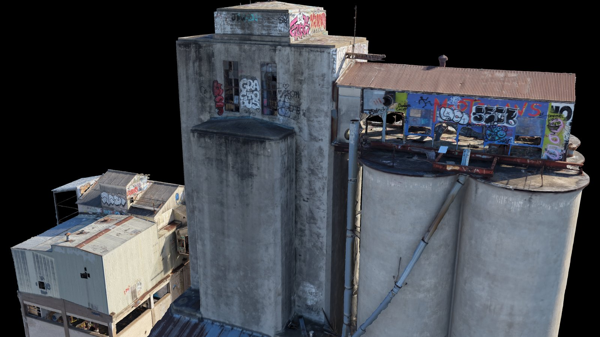 | 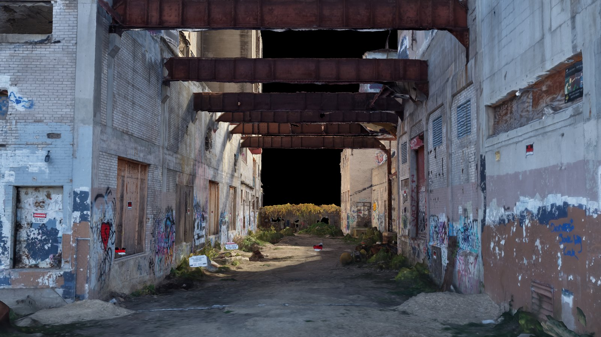 |
| 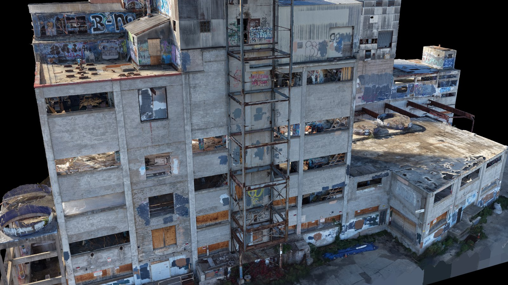 | 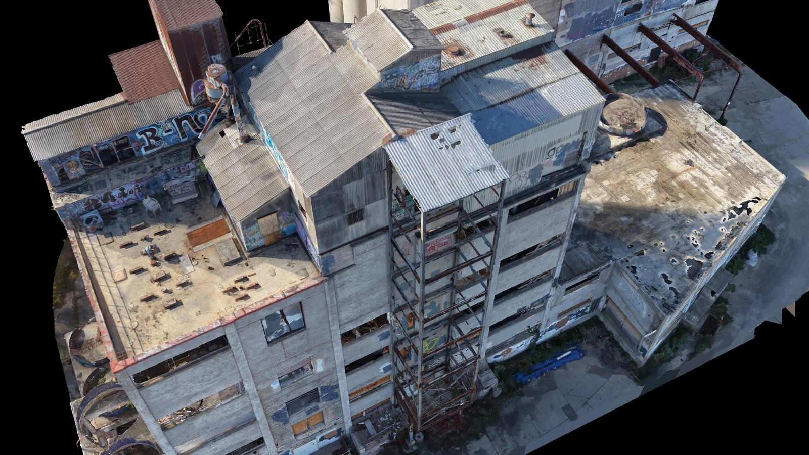 |
| 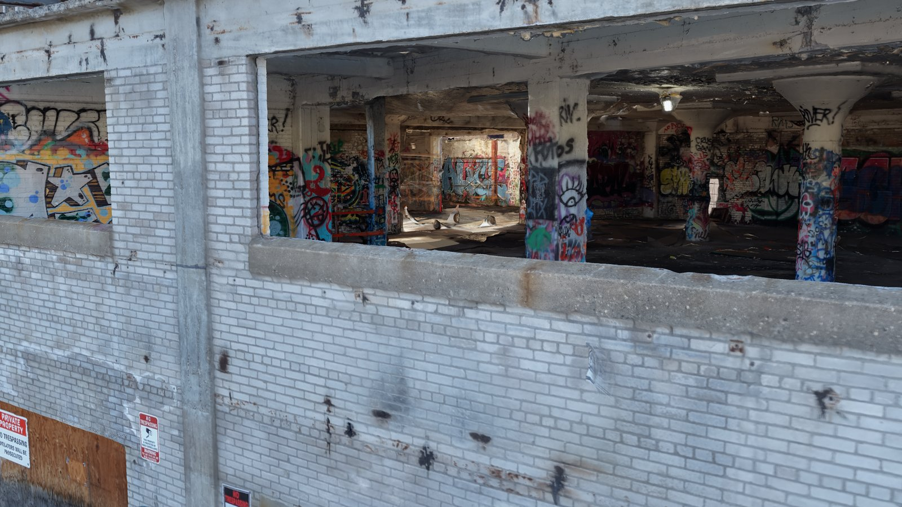 | 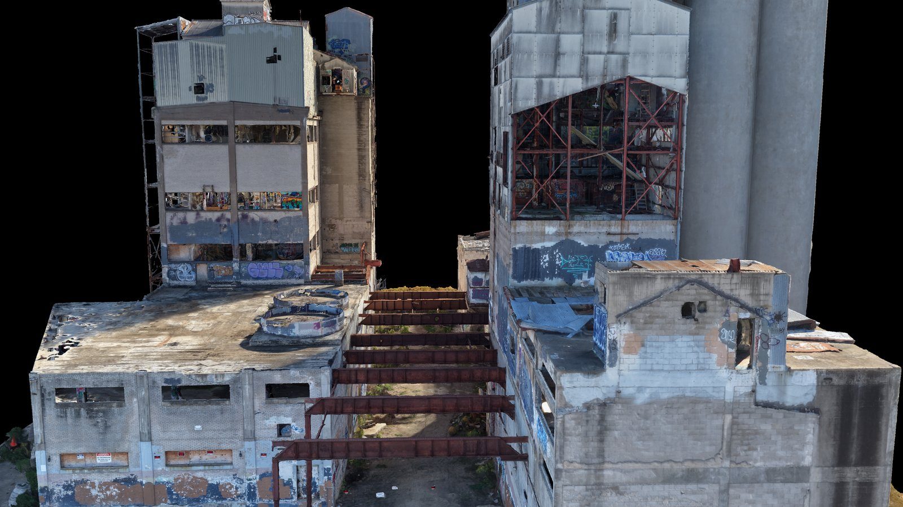 |
| 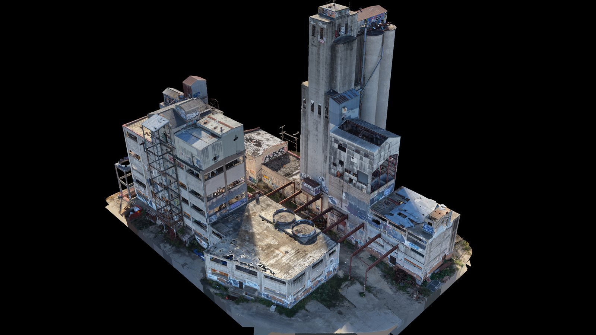 | 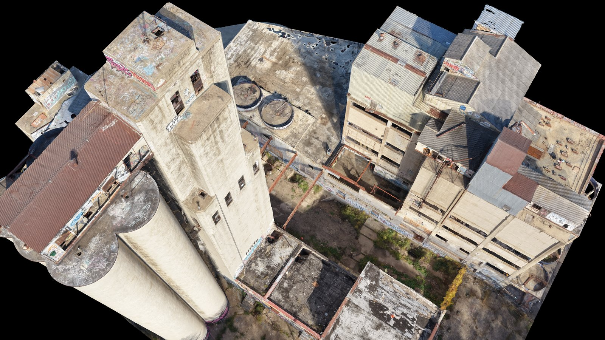 |
| 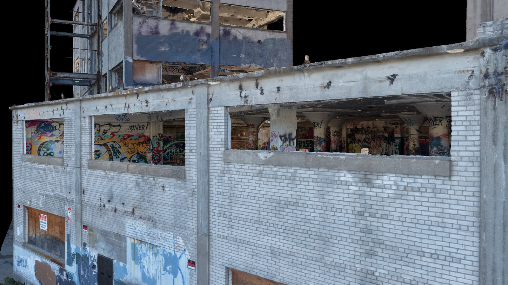 | |

## What's in it

| | |
|---|---|
| images | 1,896 |
| size | 18.85 GB |
| aligned | **1,888 / 1,896**, one component |
| interior | 233 photos, 3 spots |
| camera poses | 1,882, COLMAP and RealityScan XMP, for the original photos ([below](#camera-poses)) |
| tie points | 5,710,910 |
| scale | **metric — calibrated bar, AprilTag control points** |

## Capture

| | |
|---|---|
| **Camera** | DJI FC9313, 8.7 mm, f/1.8 |
| **Resolution** | 4096 × 3072 — native sensor readout, not an interpolated mode |
| **ISO** | 100 throughout |
| **Geotagging** | GPS on every frame — 1,896 / 1,896 |
| **Filenames** | original as written by the aircraft |
| **Files** | 1,863 camera originals, byte for byte; 33 with faces or license plates blurred ([below](#blurred-faces-and-plates)) |
| **Flown** | October 11, 2026, 14:44–17:05 local time, six battery sessions |
| **Height** | 2.1 m to 76.4 m above the takeoff point |
| **Gimbal** | −90° (straight down) to +28.5° (looking up) |

Native resolution matters. These drones offer a higher-megapixel mode that interpolates from
the same sensor well — it invents texture, and a photogrammetry solver treats invented texture
as real observations. Everything here is the native readout.

## Blurred faces and plates

People were at the site while it was flown. In **33 of the 1,896 images**, faces (30 images) or
license plates (3 images) are blurred; nothing else in those images was changed. **The other
1,863 are camera originals**, byte for byte.

The camera solve — poses and tie points — was computed from the unblurred originals.

In the 33, the image keeps its 4096 × 3072 size and was re-encoded with the camera's own JPEG
quantization tables; EXIF and DJI XMP are copied byte for byte. The EXIF thumbnail was remade
from the blurred pixels, and DJI's embedded 960 × 720 preview image was removed, since it would
have shown the faces. The list is also in
[`manifest/mill/blurred.txt`](https://github.com/Matt1Up/abandoned-graffiti-mill-photogrammetry-dataset/blob/main/manifest/mill/blurred.txt)
and in the `edited` column of `images.csv`.

<details>
<summary>The 33 files</summary>

Faces blurred (30):

```
DJI_20261011154530_0967_D.JPG
DJI_20261011154533_0968_D.JPG
DJI_20261011155406_0055_D.JPG
DJI_20261011155409_0056_D.JPG
DJI_20261011155412_0057_D.JPG
DJI_20261011155415_0058_D.JPG
DJI_20261011155418_0059_D.JPG
DJI_20261011155421_0060_D.JPG
DJI_20261011155424_0061_D.JPG
DJI_20261011155430_0063_D.JPG
DJI_20261011155433_0064_D.JPG
DJI_20261011155436_0065_D.JPG
DJI_20261011155439_0066_D.JPG
DJI_20261011155442_0067_D.JPG
DJI_20261011155445_0068_D.JPG
DJI_20261011155448_0069_D.JPG
DJI_20261011155451_0070_D.JPG
DJI_20261011155454_0071_D.JPG
DJI_20261011155457_0072_D.JPG
DJI_20261011155500_0073_D.JPG
DJI_20261011155649_0099_D.JPG
DJI_20261011155655_0101_D.JPG
DJI_20261011155658_0102_D.JPG
DJI_20261011155809_0118_D.JPG
DJI_20261011155838_0126_D.JPG
DJI_20261011155841_0127_D.JPG
DJI_20261011155844_0128_D.JPG
DJI_20261011155850_0130_D.JPG
DJI_20261011155908_0136_D.JPG
DJI_20261011155914_0138_D.JPG
```

License plates blurred (3):

```
DJI_20261011155835_0125_D.JPG
DJI_20261011161645_0434_D.JPG
DJI_20261011161648_0435_D.JPG
```

</details>

## Scale

**The scan is metrically scaled from a physical reference.** A calibrated bar carrying two
AprilTag 36h11 markers was laid on the ground and used as control points.

| | |
|---|---|
| bar length | **1.996 m**, center of tag to center of tag (78 19/32 in) |
| tag family | AprilTag 36h11 |
| measured in the published poses | 1.9965 m — 0.2 mm (0.01 %) from the calibrated length |
| control points | [`poses/mill/controlpoints.txt`](https://github.com/Matt1Up/abandoned-graffiti-mill-photogrammetry-dataset/blob/main/poses/mill/controlpoints.txt) |

The tags are visible in the imagery, so the scale is checkable from the data rather than
something you take on trust. The figure above is exactly that check: both tags detected in the
original photos and placed through the published cameras, lens distortion included.
`controlpoints.txt` gives each tag's position in the frame of the poses.

**Watch the tag IDs.** RealityScan labels 36h11 tags on its own scheme, not the official one.
`controlpoints.txt` records them as `36h11:001` and `36h11:002` — those are RealityScan's
labels. Under the official 36h11 numbering that most detectors (OpenCV, the apriltag library)
report, the same two tags come back as **476** and **283**.

## Camera poses

Solved in RealityScan 2.2, exported for **the original photos**: the files in `mill/images/`,
as they are. No undistortion is needed to use them.

- **One camera per photo.** RealityScan solved the focal length, principal point and lens
  distortion of each photo separately, so `cameras.txt` holds one camera for every image.
  Forcing one shared camera onto all of them fits these poses clearly worse.
- **OpenCV distortion.** COLMAP's `FULL_OPENCV` model: radial k1, k2, k3 and tangential p1, p2,
  with k4–k6 zero. The coefficients describe the original 4096 × 3072 photos.
- **Metric**, in meters, in the same frame as the
  [control points](https://github.com/Matt1Up/abandoned-graffiti-mill-photogrammetry-dataset/blob/main/poses/mill/controlpoints.txt).
- **1,882 poses.** 1,888 photos aligned, and 6 of them are left out of the poses (below).

| file | GitHub | Hugging Face | size |
|---|---|---|---|
| `cameras.txt`, `images.txt` | [`poses/mill/colmap/`](https://github.com/Matt1Up/abandoned-graffiti-mill-photogrammetry-dataset/tree/main/poses/mill/colmap) | `mill/poses/colmap/` | 0.5 MB |
| `points3D.txt` — the 5,710,910 tie points, position and color | too big for GitHub | [`mill/poses/colmap/points3D.txt`](https://huggingface.co/datasets/Matt1up/abandoned-graffiti-mill-photogrammetry/resolve/main/mill/poses/colmap/points3D.txt) | 0.43 GB |
| RealityScan XMP, one per photo, named after it | [`poses/mill/xmp/`](https://github.com/Matt1Up/abandoned-graffiti-mill-photogrammetry-dataset/tree/main/poses/mill/xmp) | `mill/poses/xmp/` | 2.1 MB |

Checksums for all of them are in
[`manifest/mill/poses.sha256`](https://github.com/Matt1Up/abandoned-graffiti-mill-photogrammetry-dataset/blob/main/manifest/mill/poses.sha256).
RealityScan does not export which photos saw each tie point, so `points3D.txt` has no tracks and
the point lines in `images.txt` are empty.

**6 cameras are left out** because they solved with impossible focal lengths, 27–974 mm
against 23.95 mm for the rest: close-ups of repeating metal cladding that the matcher could not
tell apart. Their photos still ship. They are listed in
[`suspect_cameras.txt`](https://github.com/Matt1Up/abandoned-graffiti-mill-photogrammetry-dataset/blob/main/poses/mill/suspect_cameras.txt).

## Gaussian splatting

Poses and tie points are what 3DGS and NeRF pipelines ingest, so the scan trains without
running structure-from-motion first. Tools that accept only pinhole cameras, such as the
reference 3DGS code, need undistorted copies first; COLMAP's `image_undistorter` makes them
from these files. Downsample to ~1600 px before training. The interior frames make this a
harder case than a building shell: three rooms joined to the exterior through window openings.

## Reproducing

The images are ordinary geotagged JPEGs, so any structure-from-motion tool reads them. See
[docs/reproduce.md](https://github.com/Matt1Up/abandoned-graffiti-mill-photogrammetry-dataset/blob/main/docs/reproduce.md)
for what to expect.

## Download details

**→ [huggingface.co/datasets/Matt1up/abandoned-graffiti-mill-photogrammetry](https://huggingface.co/datasets/Matt1up/abandoned-graffiti-mill-photogrammetry)**

**Everything in one file** — the ZIP, 18.85 GB (18,851,082,050 bytes). Stored, not
compressed: the JPEGs inside are the original files, byte for byte, in one folder.

```bash
curl -LO https://huggingface.co/datasets/Matt1up/abandoned-graffiti-mill-photogrammetry/resolve/main/zip/abandoned-graffiti-mill-images.zip
sha256sum abandoned-graffiti-mill-images.zip
# 4bb2ed0f616fbb8f97b3cbf0f53dc8ea73a104ad3e94c901ef6245f92623662a
unzip abandoned-graffiti-mill-images.zip
```

If the download stops, `curl -C - -LO <same URL>` carries on from where it stopped.

**One file at a time, one command.** Run it again if it stops — finished files are skipped.

```bash
pip install -U huggingface_hub
hf download Matt1up/abandoned-graffiti-mill-photogrammetry --repo-type dataset --local-dir ./mill --include 'mill/images/*'
```

Leave out `--include` to take everything: images, ZIP and poses (38.14 GB — the images twice).

**Or the helper scripts** from the [GitHub repo](https://github.com/Matt1Up/abandoned-graffiti-mill-photogrammetry-dataset),
which wrap the same command and add `verify.sh` to check every file against the published
SHA-256 lists:

```bash
git clone https://github.com/Matt1Up/abandoned-graffiti-mill-photogrammetry-dataset && cd abandoned-graffiti-mill-photogrammetry-dataset

./scripts/download.sh --images   # 18.85 GB, file by file
./scripts/download.sh --zip      # 18.85 GB, one file
./scripts/download.sh --poses    # poses, tie points, control points (0.43 GB)
./scripts/verify.sh
```

More detail in **[docs/download.md](https://github.com/Matt1Up/abandoned-graffiti-mill-photogrammetry-dataset/blob/main/docs/download.md)**.

## Notes

- **The graffiti is not covered by this license.** CC BY 4.0 covers the photographs and the
  data derived from them. The artworks in them belong to the people who made them. Trademarks
  and signage visible in the images belong to their owners.
- Some frames look out past the site to neighboring buildings, streets and parked cars.
- 8 of 1,896 images do not align ([`unaligned.txt`](https://github.com/Matt1Up/abandoned-graffiti-mill-photogrammetry-dataset/blob/main/poses/mill/unaligned.txt)). 6 more solved with impossible focal lengths and are left out of the poses ([`suspect_cameras.txt`](https://github.com/Matt1Up/abandoned-graffiti-mill-photogrammetry-dataset/blob/main/poses/mill/suspect_cameras.txt)).

## License

[](https://creativecommons.org/licenses/by/4.0/)

[Creative Commons Attribution 4.0](LICENSE). Commercial use and ML training are fine. Credit required.

```
Abandoned Graffiti Mill (Früen Mill, Minneapolis) — Matthew Guertin, 2026. CC BY 4.0.
https://github.com/Matt1Up/abandoned-graffiti-mill-photogrammetry-dataset
```

## Related

- **[Thirteen Mission Waypoint Drone Survey](https://github.com/Matt1Up/plymouth-mn-residential-survey-photogrammetry-dataset)** — 1,421 images of a residential complex in Plymouth, Minnesota: crosshatched nadir grids and 11 orbits, with COLMAP poses.
- **[Drone building scans](https://github.com/Matt1Up/drone-building-scans-dataset)** — two commercial buildings, with poses.
- **[Tree photogrammetry dataset](https://github.com/Matt1Up/tree-photogrammetry-dataset)** — 812 images of one tree, with COLMAP poses.
- **[Chicago / Grant Park](https://github.com/Matt1Up/chicago-photogrammetry-dataset)** — 2,751 aerial images and 241 laser scan files over downtown Chicago.
- **[mattguertin.com](https://mattguertin.com)**
